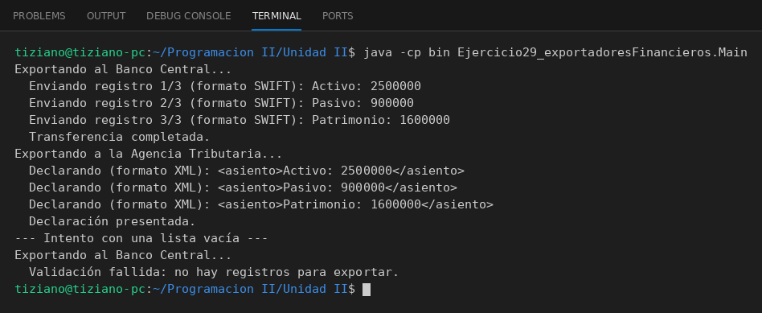

# ExportadorFinanciero

Programación II - Unidad 2 - Ejercicio 29

## Consigna
Exportar balances a distintos destinos con una clase abstracta que ya incluye la validación común.

## Lógica
- Clase abstracta `ExportadorFinanciero` con un método concreto `validarRegistros` (rechaza listas nulas o vacías) y el abstracto `exportarDatos(List<String>)`.
- `ExportadorBancoCentral` y `ExportadorAgenciaTributaria` sobrescriben la exportación e informan el progreso.
- `Main`: exportación polimórfica de un balance y un intento con lista vacía.

## Ejecución

